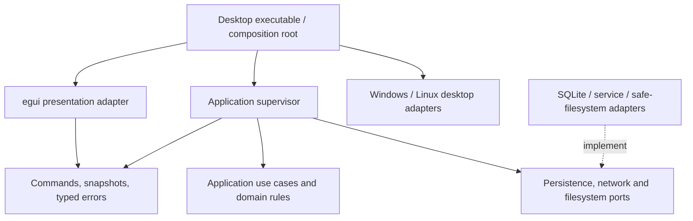

# Rust Desktop Standard — revision 0.1

Status: selected implementation standard, revision 0.1, 2026-11-14. Selection does
not certify implemented capability or a dependency graph. The [project brief](project.md) owns selection and
authorization; the [rewrite plan](rust-rewrite-plan.md) applies this standard to
Immich Folder Watch. Existing .NET engineering rules remain applicable to the
shipping reference product; Rust uses this standard under the selected milestone.

## Purpose and boundaries

Provide a reusable foundation for per-user Windows and Linux desktop applications
with background work, native desktop integration, safe persistence and automated
distribution. The user clarified that **100% Rust means all first-party application
code, including the GUI**. OS libraries, drivers, SQLite and other reviewed native
dependencies are permitted. No WebView, JavaScript application frontend, Electron
or embedded .NET application runtime is part of the target product.

Build manifests, translations, SQL, SVG, installer definitions and CI orchestration
are data/tooling, not a second application runtime. Prefer Rust `xtask` for new
repository-owned build logic. Invoking WiX or an OS packaging tool does not make
the shipped application a .NET application. Third-party GitHub Actions may have
their own runtimes; audit them separately from shipped dependencies.

The initial reusable crates inherit **AGPL-3.0-only**. Reusability does not grant
permission to relicense existing code or to include the foundation in an
incompatible proprietary application. A different license for separately owned
future generic code requires a deliberate decision and provenance review.

## RDS-01: dependency direction

Use ports and adapters with an executable that assembles concrete dependencies.
Keep domain types and application commands independent of the renderer, operating
system, HTTP client and database implementation.



- Domain and application crates must not depend on egui, eframe, winit, D-Bus,
  Windows bindings or rusqlite. A dependency-boundary check enforces this.
- Presentation translates user intent into commands and renders snapshots. It
  must not perform SQL, HTTP, filesystem mutation or blocking waits during a frame.
- Platform interfaces describe capabilities and failures, including unavailable
  tray, denied portal permission and unsupported filesystem operations. They must
  not report successful execution when only a request was accepted.
- Keep interfaces small and concrete: no general plugin framework, distributed
  service bus, blanket repository abstraction or renderer-neutral widget library.
  Implement the first real consumer before extracting speculative abstractions.

## RDS-02: lifecycle and concurrency

One per-user application process owns one desktop event loop and one supervised
background runtime. The desktop loop runs on the required main thread; Tokio
owns asynchronous work. A dedicated database worker owns synchronous SQLite
connections. Blocking filesystem/hash work uses bounded workers, retaining
operation handles until completion. Cancelling a future is not proof that a
blocking operation stopped.

- Explicit lifecycle: Starting → Running → Reconfiguring/Stopping → Stopped,
  with recoverable failure states. Window visibility is separate from engine state.
- Hide, reopen, restart workers, quit, session shutdown and installation shutdown
  are distinct commands. Closing the last visible window must not accidentally
  drop the engine; Quit waits for durable operation completion and lease release.
- Use bounded command/event channels, coalesced latest-value status snapshots and
  a bounded log ring. UI queue saturation must not lose critical user commands;
  return a visible busy state or apply bounded backpressure. Notifications and
  progress must not grow an unlimited queue.
- Every engine generation has a token. Ignore stale asynchronous results from a
  stopped generation. On reconfiguration, persist the validated configuration,
  stop/join the old engine, then construct the new one; never overlap writers.
- Use event-driven repainting. Hidden/idle windows do not run a continuous frame
  timer. Background work has no dependency on frames being painted.
- Failures are typed and user-actionable; secrets are never part of `Debug`, log
  fields, URLs in diagnostic output, panic messages or crash uploads. No automatic
  telemetry or crash upload is introduced by this standard.

## RDS-03: native desktop services

Keep these interfaces in the platform boundary, with per-platform implementations:

| Interface | Contract |
| --- | --- |
| `AppPaths` | Stable app identity and per-user directories; no accidental switch to a fresh profile |
| `SingleInstance` | User-scoped writer ownership across sessions sharing a profile, bounded authenticated local activation, stale-endpoint recovery |
| `FolderGrant` | Authorized OS path/handle, persisted portal identity, display path, revocation state |
| `BackgroundPermission` / `Autostart` | Requested, granted, denied and unavailable are distinct; user choices persist |
| `Tray` | Availability after acknowledged registration; Open/Restart/Quit; reconnect when host returns |
| `Notifications` | Stable event IDs, rate limiting, no credentials or sensitive filenames in default messages |
| `Appearance` | System light/dark, scale changes, accessibility/high-contrast capability |
| `PlatformLog` | Per-user logs and native logging targets without runtime privilege escalation |

Windows uses native APIs/COM through Rust bindings. Linux uses portals and D-Bus;
Flatpak never gains blanket home/host access merely to simplify implementation.
Do not replace a denied portal request with direct unrestricted access.
Visible fallback and launcher activation must work without a tray host.

## RDS-04: safe data and filesystem operations

Use a small separately reviewed capability boundary for sensitive file access.
An authorized root, an opened file and a staged transaction own handles and
identity checks. Arbitrary absolute strings are not authority. Directory
enumeration and absence decisions use the same authorized root as mutations.

The boundary exposes operations such as `open_verified`, `begin_download`,
`publish_no_replace`, `delete_verified` and `set_times_verified`. These names
describe proposed contracts, not implemented APIs. Fail closed when the filesystem
cannot satisfy a required atomic operation; never silently fall back to
`canonicalize` followed by an ordinary path-based operation.

Business crates forbid first-party unsafe code. Any necessary unsafe/FFI is
confined to platform/security modules with ownership, aliasing, ABI, handle-lifetime
and cancellation invariants documented at the call sites. Review transitive native
code independently; Rust does not prevent authorization, TOCTOU or data-loss bugs.

Persist durable intent and acknowledged outcomes around non-atomic external side
effects. A database transaction cannot atomically include an HTTP request or a
filesystem rename. Recovery must tolerate every boundary without assuming an
unacknowledged operation never happened. Report success only after its required
durable state is committed. Protect backups and journals like their source data.

## RDS-05: configuration and compatibility

- Separate editable draft, validated configuration and currently applied state.
  Validation failure must not save or restart. Surface partial failure after a
  successful save explicitly.
- Treat persisted formats, identities, CLI options, installation paths and defaults
  as public contracts. Use explicit format adapters and version checks rather than
  relying on serializer defaults.
- Use atomic, permission-preserving config writes. Bound parsing, nesting, alias
  expansion and collection sizes. Disable include/environment interpolation unless
  the product explicitly defines and secures it.
- Have one application writer. SQLite locks alone do not prevent conflicting
  business operations by two different application versions. A session-scoped
  activation mutex does not establish cross-session writer exclusion.
- Back up consistently, validate before migration, reject unknown future formats,
  and test downgrade compatibility. Restoring a database cannot reverse already
  completed remote or filesystem side effects.

## RDS-06: GUI policy

The provisional default is **egui + eframe with wgpu**, subject to the feasibility
gates in the rewrite plan. This is a native executable with custom-drawn widgets,
not a promise of native OS widgets or automatic accessibility parity.

Keep egui types within presentation. Retain stable widget IDs, keyboard focus,
draft text and selection across frames/navigation. Supply product-selected locales
and translated strings outside business code (English/German for Immich Folder Watch),
live language changes, scalable layouts, system appearance,
keyboard navigation and explicit accessibility labels. Virtualize large lists and
avoid per-frame work proportional to the complete synchronization database.

Use explicit Cargo features. Do not enable all eframe defaults without review.
At the assessed 0.37.0 revision, default fonts bring additional font licenses;
the proposed profile disables bundled defaults and supplies independently reviewed
fonts. Production must not enable the optional inspection/control server. Test
instrumentation is isolated from release builds. See the exact-source evidence
and alternatives in the [GUI decision](rust-rewrite-plan.md#gui-decision).

## RDS-07: dependencies and licensing

Pin the application lockfile, compiler/toolchain and build tools. Select an exact
stable Rust toolchain meeting the highest audited MSRV; record the supported OS
floor separately. Use target-specific dependencies and explicit feature profiles.
Do not treat `--all-features` as the release profile.

Before accepting a dependency, review the exact source/license, selected features,
transitive packages, native libraries, bundled fonts/assets and build scripts.
Record SPDX expressions and preserve required license/notice files. Prefer a
compatible permissive option where a package offers a choice. An AGPL-compatible
top-level crate is not evidence that every shipped component is compatible.

Use `cargo-deny` with a reviewed policy for licenses, sources, advisories and
duplicate versions, supplemented by source/asset review and an artifact inventory.
Review exceptions individually, with an owner and expiry; do not broadly allow an
unknown license to make CI pass. Generate an SBOM and source/provenance bundle per
release. No proprietary or unverifiable component may enter the shipping profile.

The policy is grounded in the [GNU license list](https://www.gnu.org/licenses/license-list.html)
and [compatibility explanation](https://www.gnu.org/licenses/license-compatibility.en.html).
It does not certify an unresolved Cargo graph in advance.

## RDS-08: build and validation contract

Proposed targets: `x86_64-pc-windows-msvc`, `aarch64-pc-windows-msvc`,
`x86_64-unknown-linux-gnu`, `aarch64-unknown-linux-gnu`. Build and run platform
tests natively on all four. Cross-compilation is supplementary evidence only.

When the workspace exists, establish these command families in its development
guide; they are **proposed and not executed** in this analysis:

```text
cargo fmt --all -- --check
cargo clippy --workspace --all-targets --locked -- -D warnings
cargo test --workspace --locked
cargo build --release --locked --target <target-triple>
cargo deny check
cargo vendor --locked <generated-vendor-directory>
```

Resolve mutually exclusive platform/renderer profiles with an explicit matrix,
not one accidental union. Offline package reconstruction uses `--frozen` and
verified compiler, native-tool and dependency inputs; vendoring alone does not
make a build reproducible. Do not commit generated `target/` or vendor caches.
The [Cargo vendor contract](https://doc.rust-lang.org/stable/cargo/commands/cargo-vendor.html)
defines locked/offline behavior.

Layer tests: domain unit/property tests; format golden fixtures; fake-server
protocol tests; crash/failure recovery; native filesystem adversarial tests;
portal/IPC protocol tests; GUI interaction/accessibility and packaged desktop
smokes. Test deterministic pure code under Miri where applicable; native ABI and
kernel security behavior require native tests. Fuzz parsers and operation plans.
CodeQL currently supports Rust; configure and verify its actual extraction/queries
alongside other checks, not as a substitute for race tests or native review.
See [GitHub's supported languages](https://codeql.github.com/docs/codeql-overview/supported-languages-and-frameworks/).

## RDS-09: delivery and maintenance

Separate build, validation, signing, publication and downstream catalog submission.
Untrusted pull requests receive no signing/publication secrets. Pin Actions by
immutable commit and images by digest. Promote the same verified artifacts from
one source revision; never rebuild different bytes after approval.

Windows MSI and Linux Flatpak are the initial distribution standard. Preserve
application identity, upgrade transaction safety, per-user data, and the existing
Flatpak signing identity. Candidate packages never enter stable distribution.
Do not introduce a privileged self-updater; retain the product's existing update
mechanism until a separate update contract is selected.

A release is accepted only with four native artifacts, migration/rollback evidence,
license/source inventory and actual packaged-runtime checks. Publication authority
is separate from local development. Branch protection and review remain in force.

## RDS-10: proving reuse

Begin with a single workspace and narrow platform/runtime/security crates. Keep
Immich routes, synchronization modes, album ownership, config schema and legacy
database adapters outside the generic foundation. Application identities, branding,
paths, translations and notification policy enter as explicit product inputs.

Before calling the foundation reusable, build an isolated minimal second desktop
consumer that imports only the generic crates and exercises window/tray lifecycle,
settings, logs and a synthetic background task on all targets. It must neither
depend on Immich crates nor use Immich's profile/IPC names. This is a validation
fixture, not a second product roadmap. Extract a versioned template/library only
after this test exposes the real reusable boundary.
